# App design — prototype screenshots (design v2)

Screens from the Flutter prototype in [`mobile/`](../../mobile/README.md). They come from the
web build at 412×915 dp unless marked otherwise, captured 2026-11-05. All ECG traces are
synthetic and there is no patient data. Clinical texts are pending cardiologist review.

| | | |
|---|---|---|
| 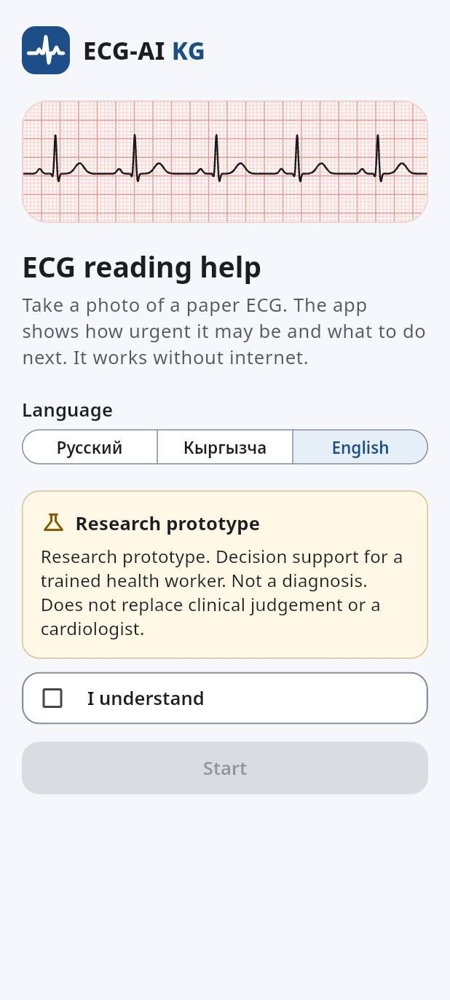 Welcome + disclaimer | 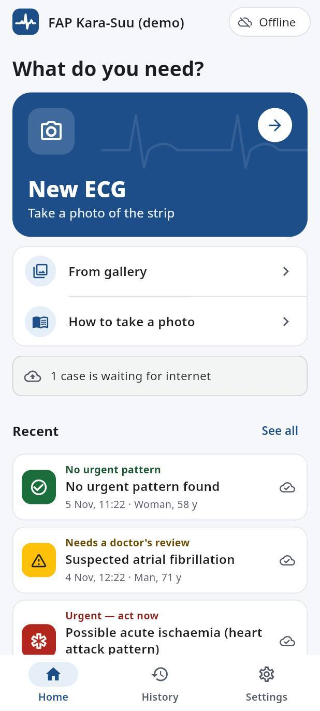 Home, one main action | 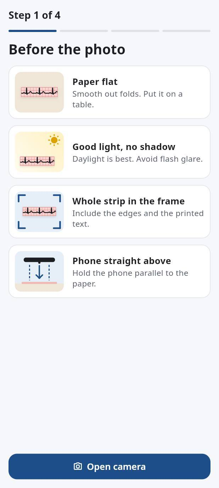 Photo checklist with drawn pictures |
| 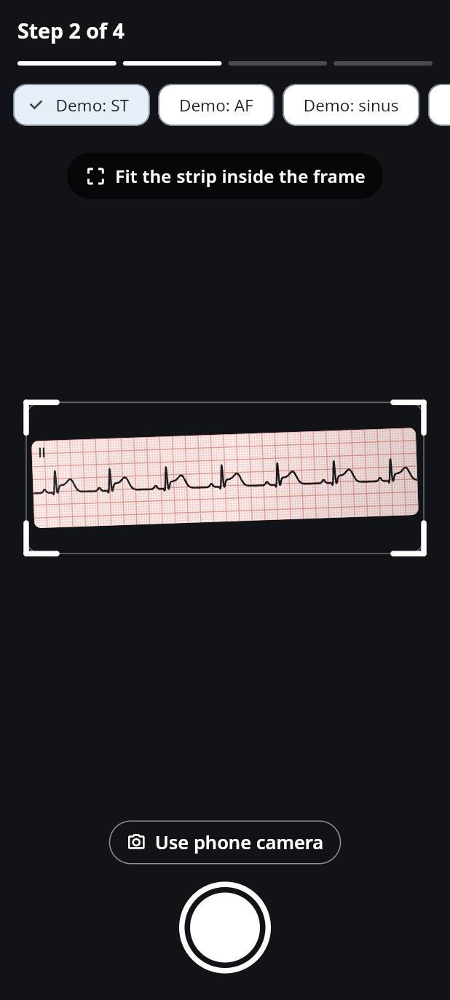 Camera + frame corners | 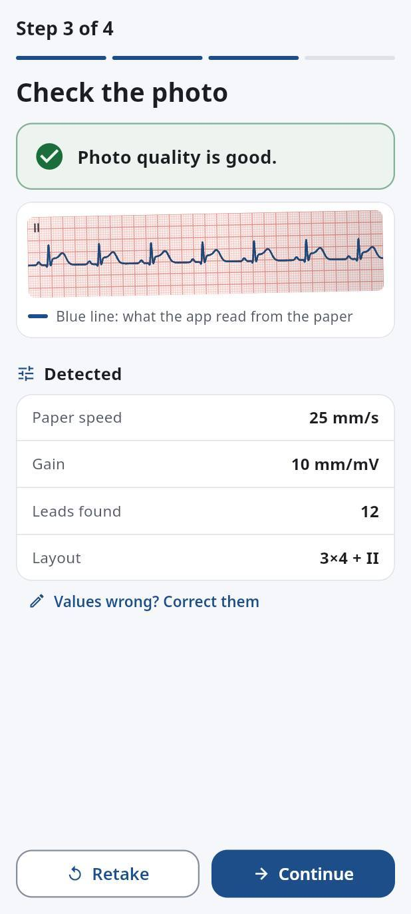 Photo check: verdict first | 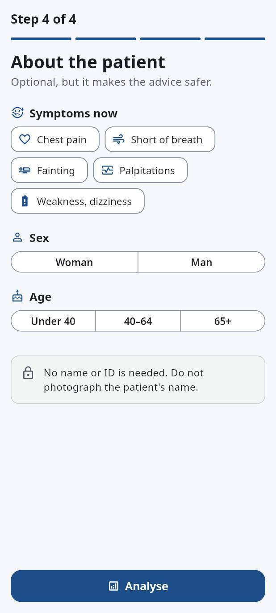 Patient (optional) |
| 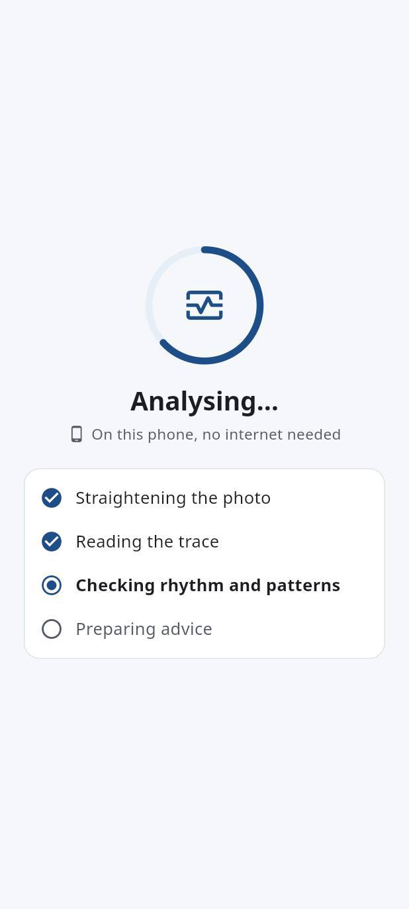 On-device processing | 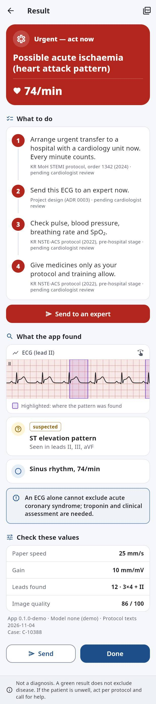 Result — red (full page) | 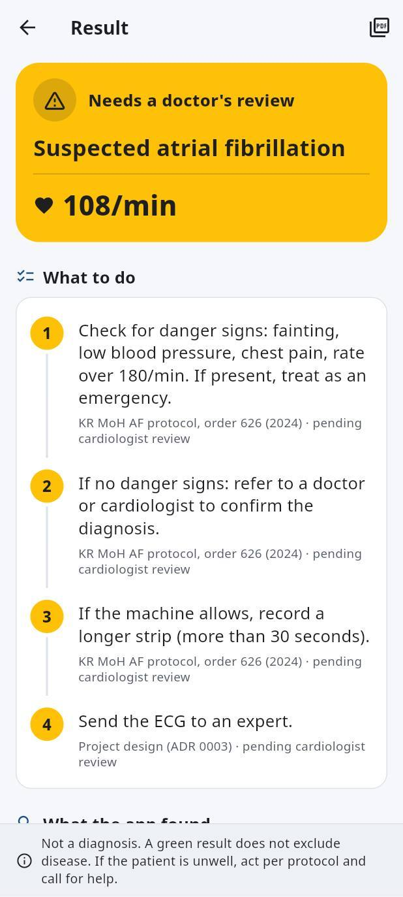 Result — amber |
| 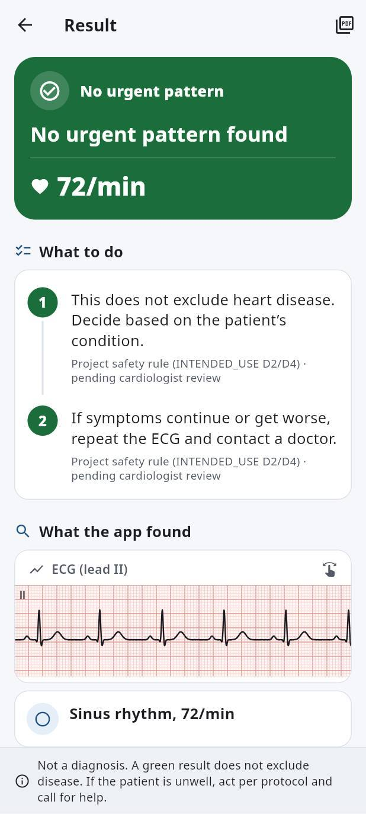 Result — green | 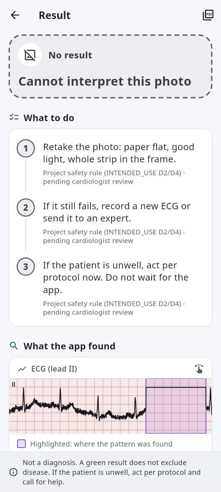 Result — no result (dashed) | 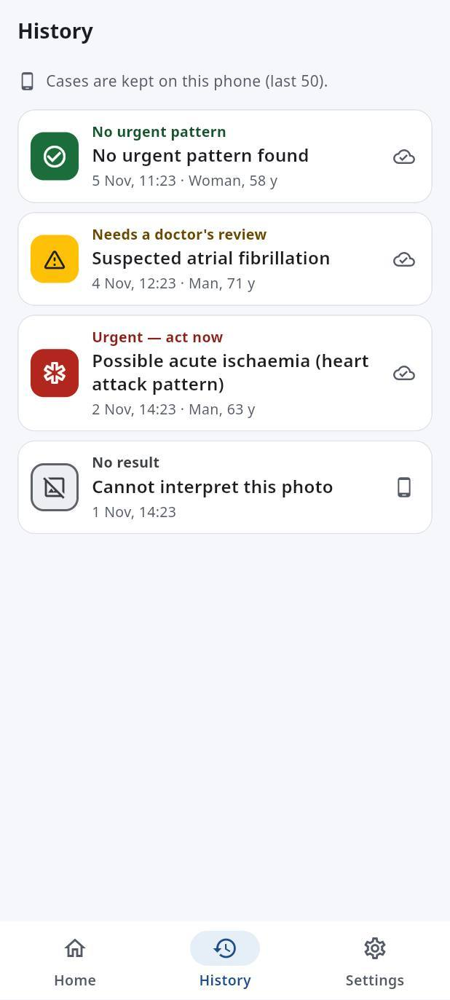 History |
| 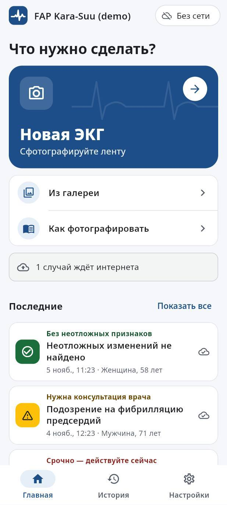 Home (RU) | 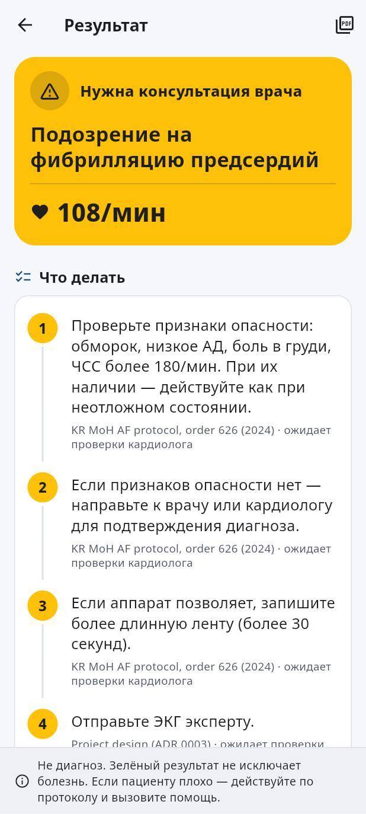 Result — amber (RU) | 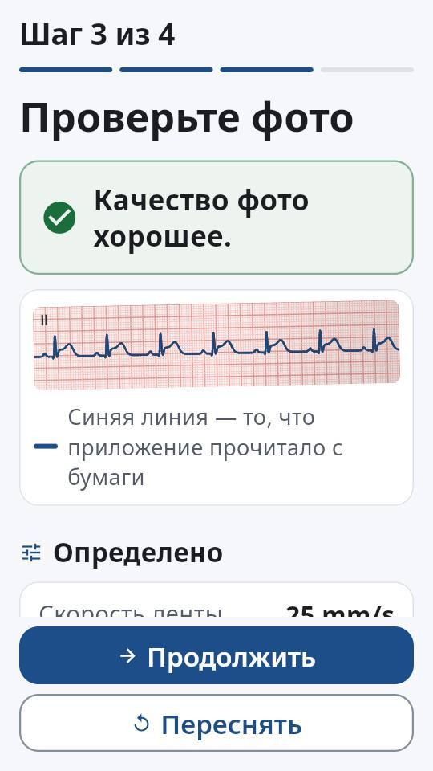 RU, 360×640 dp, font scale 1.3 |

## What changed in v2, and why

The behaviour, data models and clinical texts are unchanged. The safety rules are unchanged:
every urgency level shows colour, icon and word together; grey is outlined; a low-quality
photo is never green; the word "normal" is never used; disclaimers are where they were.

| Change | Why |
|---|---|
| Urgency banner: word in sentence case next to its icon, heart rate as a large number | Long Cyrillic words in capitals are hard to read ([research 11 §4.3](../research/11-ux-market.md)); §4.2 asks for a large heart rate |
| Grey "no result" banner has a dashed outline | Green and grey have almost the same lightness (1.04:1), so the shape has to differ (§4.4) |
| Action steps numbered and joined by a line; source text darker | The order of the steps matters; the source line was the faintest text on the screen |
| Findings follow the ECG trace and its highlights, one card per finding; "suspected" is a label, not a chip | The user can check a finding against where it was found (D8, §4.2) |
| The urgency word is shown in History and Recent rows | v1 rows had only colour and icon |
| Home: one large "New ECG" card; Gallery and How-to as list rows; empty state | One primary action per screen (§4.6); the half-width cards wrapped in Russian |
| Photo tips have small pictures drawn in code (no image assets) | Pictures beat prose (§2, §4.6) |
| Segmented step progress; a determinate ring when processing; corner marks on the camera frame | A visible end to the wait; a scanner-like frame |
| Photo-quality verdict first on the check screen; Retake is the main button when quality is poor | It is the decision the screen asks for (FR-1) |
| Paired buttons stack when the width divided by the font scale is below 370 dp | At 360 dp with font scale 1.3, Russian labels broke mid-word |
| Spacing, shape and neutral colour tokens; raw colours removed from widgets | Consistency; some v1 greys and borders were below the contrast minimums |
| App mark (one heartbeat on the brand square) in the app, launcher and web icons | v1 used a stock icon and the Flutter default launcher icon |

Not done: a dark theme (many widgets assume light cards and ECG paper, and all four urgency
fills would need a new contrast check), and new actions such as "Retake / record 12-lead" on
a grey result (spec FR-3), which change behaviour.

## Tokens (`mobile/lib/theme/tokens.dart`)

Spacing: 4, 8, 12, 16, 24, 32 dp (`s1`–`s6`). Radii: 10 (notices, tags), 16 (cards,
buttons), 24 (hero card, urgency banner). Primary buttons are at least 56 dp tall, and every
other target is at least 48 dp.

The urgency colours are unchanged from v1 (see [`mobile/README.md`](../../mobile/README.md#design-rules-from-research-11-and-docssafety)).
The other colours are new or changed in v2. Contrast was computed with the WCAG 2.x formula:

| Token | Value | Use | Contrast |
|---|---|---|---|
| `ink` | `#1B1D21` | body text | 16.9:1 on white |
| `inkMuted` | `#545B66` | secondary text, sources | 6.9:1 on white, 6.4:1 on `surface` |
| `surface` | `#F5F7FA` | page background | — |
| `brand` | `#1D4E89` | primary buttons, icons | 8.4:1 on white, 7.2:1 on `brandSoft` |
| `brandSoft` | `#E6EEF8` | tonal fill behind brand icons | — |
| `control` | `#858E9B` | borders of outlined buttons, chips and segments | 3.3:1 on white (WCAG 1.4.11) |
| `outline` | `#DDE2E9` | card borders and dividers (decorative) | — |
| `caution` | `#8A5A00` | photo-quality warning, "suspected" label, research notice | 5.9:1 on white |
| `onSoft` (per level) | red `#8C1D18`, amber `#6B4700`, green `#14532D`, grey `#3C4043` | urgency word in list rows | 9.1, 8.3, 9.1, 10.5:1 on white |
| grey dashed border | `#5F6368` | outline of the grey banner | 5.6:1 on `surface` |

Icons: `tool/gen_icons.py` draws the Android launcher and web icons. It uses Pillow, a dev
tool that is not shipped in the app. The heartbeat shape matches `AppMark` in
`lib/widgets/common.dart`.

Evidence: [research 11 — UX and market](../research/11-ux-market.md). Design rules:
[`mobile/README.md`](../../mobile/README.md#design-rules-from-research-11-and-docssafety).
