# App design — prototype screenshots

Screens from the Flutter prototype in [`mobile/`](../../mobile/README.md) (web build, 412×915 dp,
captured 2026-11-04). All ECG traces are synthetic; no patient data. Clinical texts are
pending cardiologist review.

| | | |
|---|---|---|
| 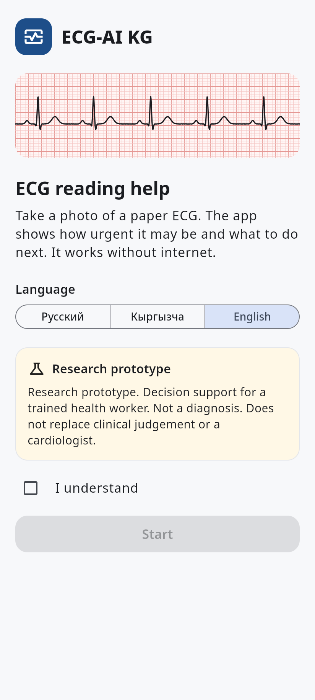 Welcome + disclaimer | 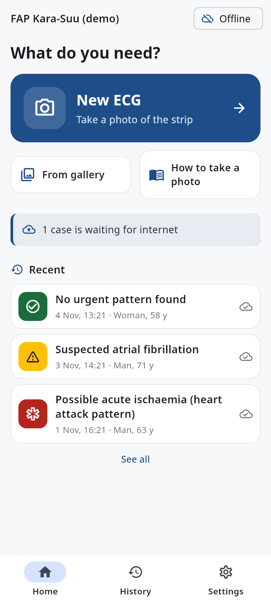 Home | 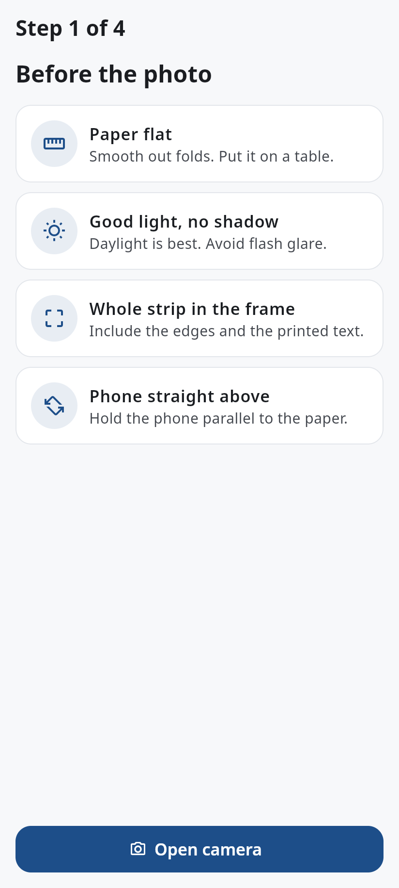 Photo checklist |
| 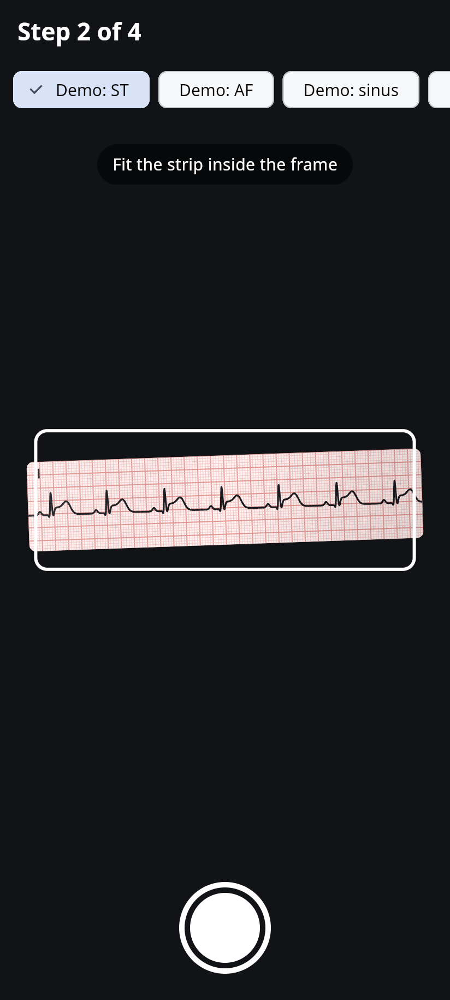 Camera + frame | 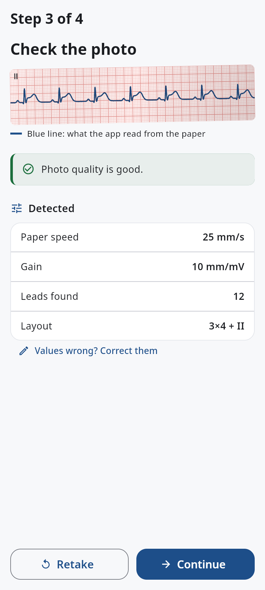 Photo check + detected values | 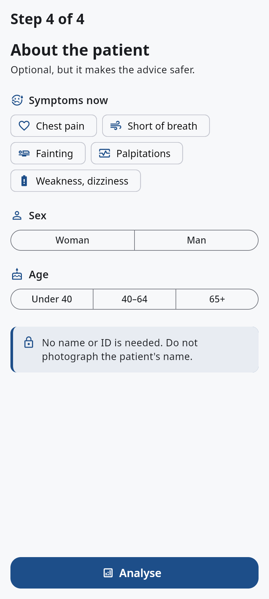 Patient (optional) |
| 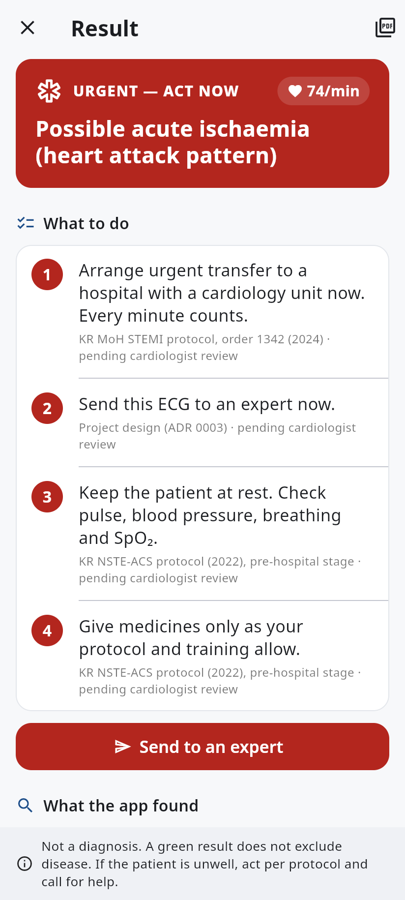 On-device processing | 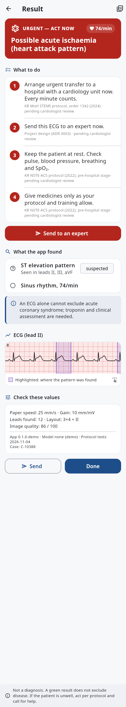 Result — red (full page) | 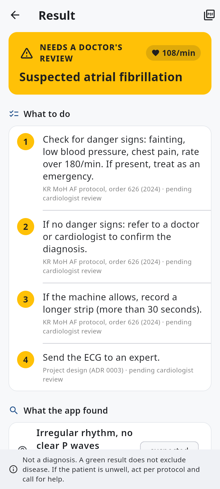 Result — amber |
| 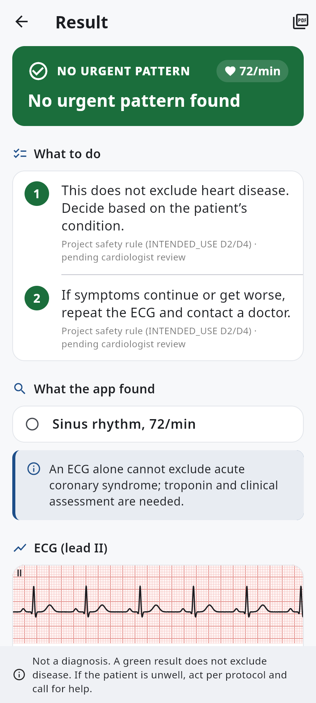 Result — green | 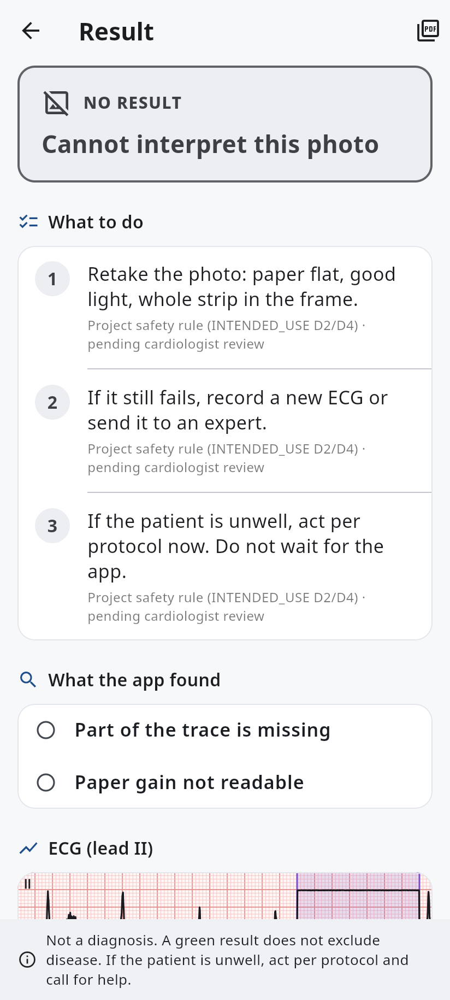 Result — no result | 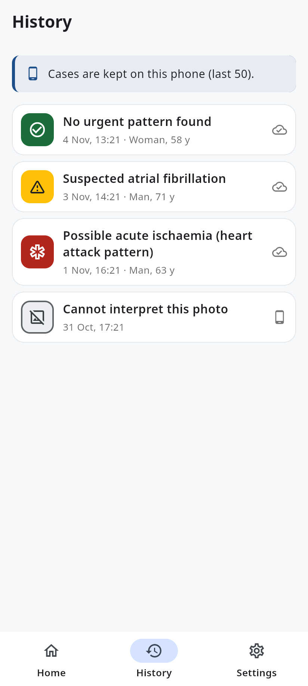 History |
| 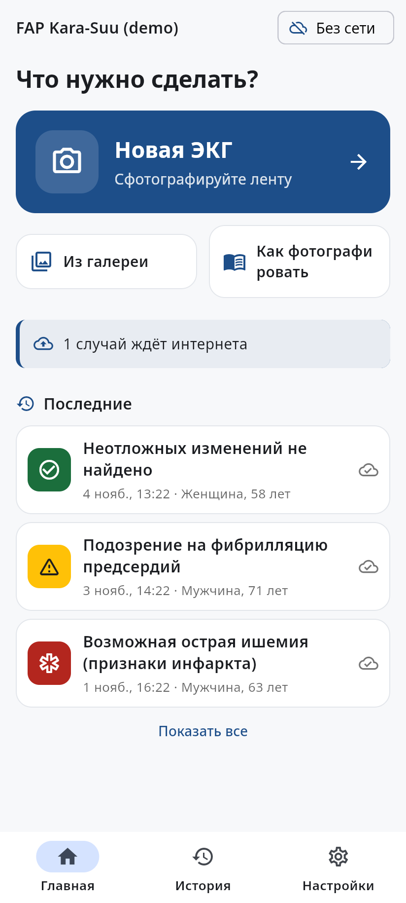 Home (RU) | 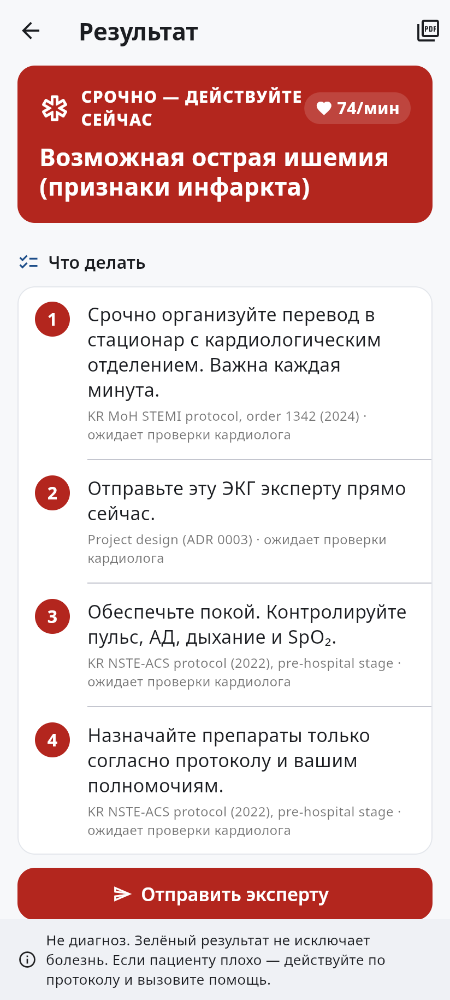 Result — red (RU) | 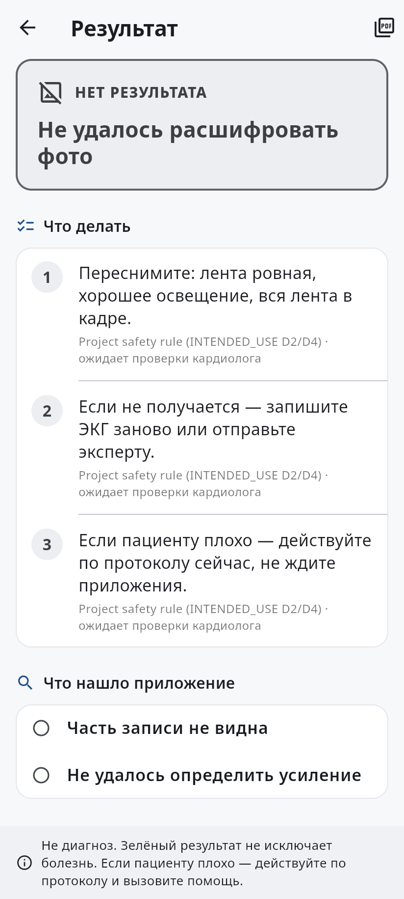 No result (RU) |

Design rules and tokens: [`mobile/README.md`](../../mobile/README.md#design-rules-from-research-11-and-docssafety).
Evidence: [research 11 — UX and market](../research/11-ux-market.md).
